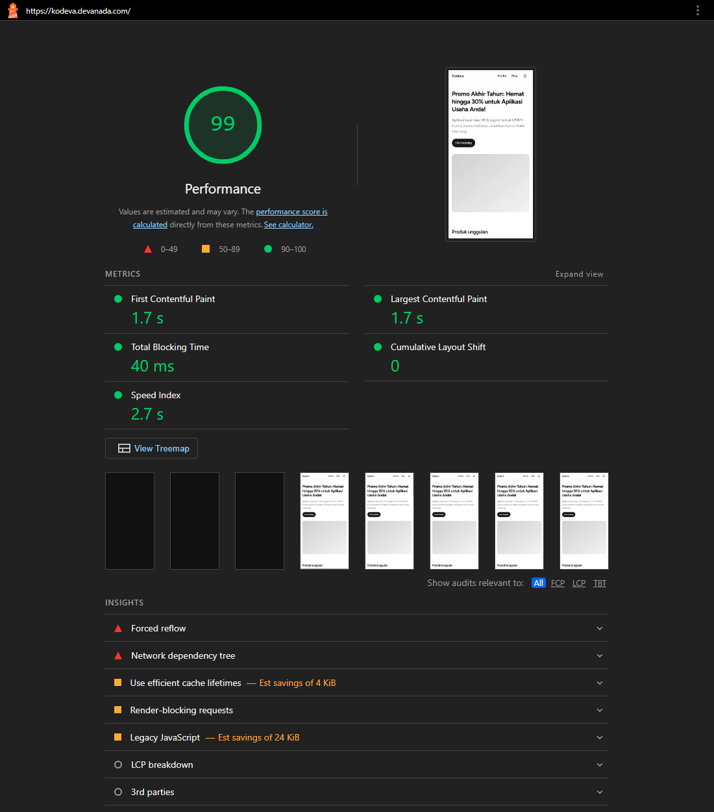

# Kodeva

Landing campaign, blog, and mini marketplace for the fictional Kodeva brand (technical skill test). Runs entirely on the
Cloudflare **Free** plan plus Sanity's free plan.

- **Live site:** https://kodeva.devanada.com (also reachable at https://kodeva.pages.dev, the same build). The custom
  domain is the canonical address: canonical tags, Open Graph URLs and the sitemap all point to it.
- **CMS (Sanity Studio):** https://devanada.sanity.studio/. The demo editor account is in the submission email.
- **AI usage log:** [AI_LOG.md](AI_LOG.md)

## Working time

Started working on the project at 12:30 PM on Oct 30, 2026 by submitting the requirements to Claude Code, vibe coding but with my personal code and structure standart to make sure that the project is align with my coding style. And finished the project at 02:30 AM on Nov 1, 2026.

The work took more than one architecture: it started as Payload CMS on Cloudflare Workers and was rebuilt as a static site
with Sanity when that proved impossible on the Workers Free plan (see "Why this architecture"). That detour is part of the
time above.

## Stack

- Next.js 16 (App Router) + TypeScript as a **static export**, served by Cloudflare Pages
- Sanity (hosted CMS + hosted Studio) for the landing page, articles, testimonials, FAQs and leads
- Cloudflare Pages Functions (`functions/`) for the two server endpoints: `POST /api/v1/leads` and `POST /api/v1/orders`
- shadcn/ui (radix-maia) + Tailwind v4, react-hook-form + zod through the `components/form-field` wrappers
- zustand (cart), Vitest (tests), Cloudflare Turnstile (lead form spam protection)

## Why this architecture

The first version ran Payload CMS inside a Cloudflare Worker. That cannot run on the Free plan: Workers Free allows
10 ms of CPU per request, while the Payload admin needs about 1 s to start and 0.2 s per request (measured locally), and
it failed in production with `Worker exceeded CPU time limit` (error 1102). Instead:

- Pages are plain static files. Requests to static assets are free, unlimited and never run a Worker, so the CPU limit does
  not apply to page views, and Lighthouse is not at the mercy of cold starts.
- The CMS is a hosted service, so nothing heavy runs on Cloudflare.
- The only code that runs on a Worker is two tiny Functions (a zod parse, one Turnstile call, one write to Sanity), which
  fit in 10 ms because waiting on `fetch` is not CPU time.

### Why Sanity

The brief allows any CMS. Sanity was chosen because it is hosted (no server of ours to run or pay for), gives non-technical
editors a ready Studio with draft/publish, image upload and rich text, has a free plan large enough for this, and its
content API is reachable from a build step. Payload, the first choice, is excellent but needs a Node runtime or a heavy
Worker; Strapi, Directus and WordPress need a server and a database; a CMS built from scratch would spend the whole time
budget on an admin UI. A git-based CMS (Decap) was the runner-up, but its editors need GitHub accounts.

### Why a static site

The marketing brief is mostly about speed and findability: 80 percent of traffic comes from phones on Instagram and TikTok,
and articles and products must be easy to find on Google. Static HTML served from the CDN is the fastest and most
crawlable option, and this content changes weekly, not per request. The price is that an edit appears after a rebuild
(about 1 to 2 minutes), which the brief explicitly asks us to explain (see "Caching and revalidation").

## Assumptions

The brief left some things open. What I assumed:

- **Where data lives.** Landing page, articles, testimonials, FAQs and leads are in Sanity. Products, plans and promo quotas
  are a JSON file because the marketplace is frontend-only. The CMS references products by slug, and the Studio only
  offers slugs that exist.
- **"Berapa orang yang klik tombol beli dari landing page".** The landing page has no buy button, only a CTA to the
  catalog. I count clicks on that CTA as `cta_click` (with the campaign), and the purchase funnel continues with
  `view_item`, `add_to_cart` and `begin_checkout`.
- **Prices.** IDR, per license per month. A promo discount applies to every plan of its product.
- **Promo quota.** One shared pool per product (not per plan), taken from the catalog JSON. With no backend it cannot go
  down when someone else buys, so "remaining quota" means the catalog quota minus what is in this visitor's cart.
- **UTM.** Last-touch: a visit with UTM parameters replaces the stored ones, a visit without keeps them. Stored in
  `localStorage` so it survives navigation and a closed tab, and is sent with the lead and the order.
- **Lead form.** Either an email or a WhatsApp number is enough. Phone numbers are validated as Indonesian by default.
- **Checkout.** "Pay" is a mock endpoint; a demo select chooses success or failure so a reviewer can see both.
- **Language.** The UI is in Indonesian; the code and docs are in English.
- **Preview of drafts.** Draft/publish is Sanity's: a draft is invisible on the site until published. A live preview of an
  unpublished draft on the site itself is not built (it needs a server-rendered preview route).
- **Dummy data.** Testimonials, articles, prices and product screenshots (gradient placeholders) are made up.

## Expansion to Malaysia and Singapore (not built)

The Head of Marketing said teams in Malaysia and Singapore will use the site from next year. Not implemented, but the
design leaves room for it:

- **Locales and routes.** `/id`, `/my`, `/sg` route prefixes with `hreflang` alternates in the metadata and the sitemap.
  Next.js `generateStaticParams` already enumerates every page at build time, so each market just adds a segment.
- **Content.** Sanity document-level translations (one document per language) with a `market` field, so each team edits
  its own landing page and articles. Editor permissions per market need Sanity roles (a paid feature); on the free plan,
  one dataset per market is the fallback.
- **Prices and currency.** Replace the single `price` per plan with a price table per market (IDR, MYR, SGD), plus tax rules
  (SST in Malaysia, GST in Singapore). `formatIdr` becomes a currency-aware formatter and the order payload carries the
  currency.
- **Tracking.** Add `market` and `currency` to every `dataLayer` event, which already carries campaign and product data.
- **Operations.** A Turnstile widget and domain per market, and the lead documents get a `market` field so teams only see
  their own leads.

## Libraries and why

| Library                                          | Why                                                                                                                                |
| ------------------------------------------------ | ---------------------------------------------------------------------------------------------------------------------------------- |
| Next.js 16 + TypeScript (strict)                 | Static export, file-based routing, per-page metadata for SEO and share previews                                                    |
| Sanity + `@sanity/client`, `@portabletext/react` | Hosted CMS with a ready Studio; the client reads at build time, Portable Text renders the rich text                                |
| Cloudflare Pages + Pages Functions + Wrangler    | Free static hosting with unlimited asset requests, and tiny Workers for the two endpoints                                          |
| Tailwind CSS v4 + shadcn/ui (radix-maia)         | Accessible, unstyled-by-default primitives that I own in the repo, fast to compose                                                 |
| react-hook-form + zod                            | One schema validates the form in the browser and again in the Function; wrappers in `components/form-field` keep fields consistent |
| zustand (`persist`)                              | Small cart store that survives refresh without a provider tree; the quota logic stays in pure functions                            |
| Cloudflare Turnstile                             | Free, privacy-friendly captcha that pairs with the honeypot and rate limit                                                         |
| libphonenumber-js                                | Real phone number validation instead of a fragile regex                                                                            |
| Vitest + Testing Library                         | Fast unit tests for quota, pricing, validation and the form states                                                                 |
| `create-next-app` + shadcn init                  | Starting point only; the form-field wrappers and project conventions come from my own earlier project                              |

I did not use TanStack Query or MSW: with static data and two POST endpoints there is nothing to cache or intercept, and
the "mock API fails" case is covered by the checkout's network error state and the Function's 402 and 500 responses.

## Run locally

```bash
cp .env.example .env
npm install
npm run mock:sanity            # terminal 1: local stand-in for the Sanity API (fixtures, 7 articles)
SANITY_PROJECT_ID=mock SANITY_API_HOST=http://localhost:4010 npm run dev   # terminal 2
```

Or point it at your own Sanity project by filling `SANITY_PROJECT_ID`, `SANITY_DATASET` and `SANITY_READ_TOKEN` in `.env`.
Without `SANITY_PROJECT_ID` the site still builds and shows its built-in fallback copy.

To exercise the Functions too (leads, orders) build the static site and serve it with workerd:

```bash
cp .dev.vars.example .dev.vars   # then add SANITY_API_HOST=http://localhost:4010 and SANITY_PROJECT_ID=mock for the mock
SANITY_PROJECT_ID=mock SANITY_API_HOST=http://localhost:4010 npm run build
npm run preview                  # static files + Functions on http://localhost:8788
```

## Scripts

| Script                         | Purpose                                                               |
| ------------------------------ | --------------------------------------------------------------------- |
| `npm run build`                | Static export to `out/` (fetches CMS content at build time)           |
| `npm run preview`              | Serve `out/` with the Functions on workerd (`wrangler pages dev`)     |
| `npm run deploy`               | Pre-flight check, build, and `wrangler pages deploy` (manual deploys) |
| `npm run seed`                 | Write demo content to Sanity (idempotent, needs `SANITY_WRITE_TOKEN`) |
| `npm run mock:sanity`          | Local mock of the Sanity API for tests                                |
| `npm run studio:dev/deploy`    | Run or publish the Sanity Studio (`studio/`)                          |
| `npm run typescript/lint/test` | Typecheck, lint, Vitest                                               |

## Structure

```
src/
  app/(frontend)/   public site: layout, landing, blog, marketplace (feature folders own their components/)
  components/       ui/ (shadcn) and form-field/ (react-hook-form wrappers)
  utils/            constants, hooks, providers, services (cms, cart, products), tracking, shared types
functions/          Cloudflare Pages Functions: api/v1/leads.ts, api/v1/orders.ts
studio/             Sanity Studio (separate package): schemas for landing page, posts, testimonials, FAQs, leads
scripts/            deploy pre-flight check, Sanity seed, mock Sanity API
```

Marketplace products come from `src/utils/services/products/products.json`; articles and the landing page reference them
by slug, and the Studio offers only the slugs that exist.

## Caching and revalidation

There is no runtime cache to invalidate: CMS content is read **at build time** and baked into the HTML. Publishing in
Sanity fires a webhook to a Cloudflare Pages **deploy hook**, which starts a rebuild; the new site goes live when it
finishes. No manual deploy is needed.

- **Consequence:** an edit appears after the rebuild, roughly 1 to 2 minutes, not instantly. Rebuilds triggered close
  together are queued, and a failed build leaves the previous site live.
- **Drafts:** the build reads the `published` perspective only, so a draft is invisible until someone presses Publish.
- **Failure on purpose:** if `SANITY_PROJECT_ID` is set and a query fails, the build fails instead of shipping an empty
  site. Only a checkout with no project id (local, tests) falls back to the built-in copy.
- **Privacy:** the dataset must be private because lead documents contain personal data. The build authenticates with a
  read-only Viewer token (`SANITY_READ_TOKEN`) that is only read while building (verified: it is not in `out/`).

## Marketing

- **Tracking:** `src/utils/tracking/data-layer.ts` pushes GA4-style events to `window.dataLayer`: `cta_click` (landing CTA),
  `view_item`, `add_to_cart`, `begin_checkout`, each with an `ecommerce` object and the campaign source/medium/name. GTM
  loads after interaction when `NEXT_PUBLIC_GTM_ID` is set.
- **UTM:** `captureUtm` stores UTM parameters on landing (last-touch, `localStorage`); the lead form and the order payload
  send them, so attribution survives navigation.
- **Lead form:** zod schema shared by the form and the Function, honeypot, Cloudflare Turnstile, and an in-memory rate limit
  (per Worker instance; use Cloudflare's rate limiting rules or KV for something stricter). Leads are created as `lead`
  documents in Sanity, so marketing reads them in the Studio, with the UTM that brought them. The Turnstile widget is
  about 0.9 MB of scripts, so it is mounted only when the form is within 600 px of the viewport or a field is focused
  (`useNearViewport`); a visitor who never scrolls to the form never downloads it, and a placeholder reserves its 65 px so
  nothing jumps.
- **Two hostnames:** the site answers on `kodeva.devanada.com` and `kodeva.pages.dev` with the same files. Every page's
  canonical URL (resolved against `NEXT_PUBLIC_SITE_URL`) points to the custom domain, so Google treats `pages.dev` as an
  alias. If you want the alias to stop answering, a Pages `_redirects` rule can 301 it to the custom domain.
- **SEO:** a static `sitemap.xml` (landing, products, articles), per-page metadata and canonical URLs, Open Graph tags,
  JSON-LD for articles and products. `NEXT_PUBLIC_SITE_URL` is normalized (a trailing slash does not double up in the
  sitemap).
- **Share previews (WhatsApp, Facebook, LinkedIn, X):** every page has an absolute `og:image` and a `twitter:image`:
  `public/og-default.png` (1200x630, 40 KB, small because WhatsApp skips large images), or, for an article with a cover,
  the cover cropped to 1200x630 by Sanity's image CDN. A page that defines its own `openGraph` replaces the parent's
  including images, so each such page sets the default explicitly (`DEFAULT_OG_IMAGE` in `src/utils/constants/site.ts`).

### Proof that the events fire

Events go to `window.dataLayer` in GA4 format; no GA account is needed. To check them yourself, open the site from a
campaign link, use it, then run this in the browser console:

```js
dataLayer.filter((e) => ['cta_click', 'view_item', 'add_to_cart', 'begin_checkout'].includes(e.event));
```

I did exactly that on the deployed site (https://kodeva.pages.dev/?utm_source=instagram&utm_medium=social&utm_campaign=akhir-tahun),
clicking through with client-side navigation so the page was never reloaded: hero CTA, open Kodeva Kasir, switch plan four
times, add 2 licenses of the Pro plan, open the cart, go to checkout. Result:

| Step                                  | Event            | Count   | Payload (shortened)                                                                           |
| ------------------------------------- | ---------------- | ------- | --------------------------------------------------------------------------------------------- |
| Click the hero CTA                    | `cta_click`      | 1       | `cta_id: hero_catalog`, `cta_destination: /products`, campaign `instagram/social/akhir-tahun` |
| Open the product page                 | `view_item`      | 1       | `currency: IDR`, `value: 69300`, item `kodeva-kasir`, variant `basic`, price 69300            |
| Switch plan Pro, Business, Basic, Pro | `view_item`      | still 1 | no new event: re-renders do not resend it                                                     |
| Add 2 licenses (Pro)                  | `add_to_cart`    | 1       | `value: 278600`, item `kodeva-kasir`, variant `pro`, quantity 2, price 139300                 |
| Open checkout                         | `begin_checkout` | 1       | `value: 278600`, the same cart item                                                           |

Every event also carries `campaign_source`, `campaign_medium` and `campaign_name` from the stored UTM. The guards that
prevent duplicates: `view_item` and `begin_checkout` are sent from an effect guarded by a ref, and `add_to_cart` and
`cta_click` from click handlers, never from render. Before each ecommerce event the previous `ecommerce` object is cleared
(`{ ecommerce: null }`), as GA4 recommends.

## Marketplace

Frontend-only; the order endpoint is a mock.

- **Catalog** (`/products`): all cards are in the HTML; the category filter only hides cards.
- **Detail** (`/products/[slug]`): the plan picker changes the price, promo shows a strikethrough regular price and the
  remaining quota (promo quota minus what is already in the cart).
- **Quota rule:** the promo quota belongs to the product, so Basic, Pro and Business draw from one pool. The pure functions in
  `src/utils/services/cart` enforce it on add, on quantity change, when restoring a saved cart, and again on the server
  (`validateLines`), and are covered by tests.
- **Cart:** zustand with `persist` (localStorage), restored after mount and sanitized against the catalog; the header cart
  button with a badge is on every page.
- **Checkout** (`/checkout`): react-hook-form + zod, order summary, then `POST /api/v1/orders`, which ignores client prices,
  recomputes totals, re-checks quota and returns paid (201) or declined (402). A demo select picks the outcome.
- **States:** loading (cart hydration skeleton, submit spinner), empty (cart, checkout, filter), error (failed payment with
  retry, network error), not found (a real 404 from `404.html`).

### Connecting the marketplace to a real backend

- **Endpoints:** `GET /products`, `POST /carts/validate` (quota and price check), `POST /orders` (creates a pending order and a
  payment intent), `POST /webhooks/payment`, `GET /orders/:id`.
- **Payment flow:** the server creates the order from the cart and recomputes every price; the client never sends amounts. The
  gateway calls the webhook, which verifies the signature, is idempotent on the gateway event id, and moves the order
  `pending -> paid | failed | expired`. The redirect page only reads order status; it never marks anything paid.
- **Accurate quota:** reserve licenses in a transaction when the order is created (`UPDATE promo SET remaining = remaining - n
WHERE remaining >= n`), with a reservation expiry; release on failure or expiry and consume on `paid`. The per-product pool
  mirrors the rule already implemented in `cart/index.ts`. (On Cloudflare this is a D1 transaction or a Durable Object per
  product, since D1 alone has no row locks.)
- **License delivery:** after the verified `paid` webhook, generate the license keys in the same transaction as the status
  change, then email them through a queue (retries, idempotent), and show them in the account/order page.

## Deploy (Cloudflare Pages + Sanity)

Everything below is free. Do the steps in order; each command is meant to be run from the repo root unless it says otherwise.

**1. Sanity project (once)**

1. Create a project at [sanity.io/manage](https://www.sanity.io/manage) and note the **project id**.
2. Make the dataset private (it will contain leads): `cd studio && npx sanity login && npx sanity dataset visibility set production private`.
3. Under API > Tokens create two tokens: **Viewer** (read-only, for the build: `SANITY_READ_TOKEN`) and **Editor**
   (for the lead Function and the seed: `SANITY_WRITE_TOKEN`).
4. Publish the Studio (marketing signs in here): copy `studio/.env.example` to `studio/.env` and fill in
   `SANITY_STUDIO_PROJECT_ID` (the same project id) and `SANITY_STUDIO_HOST` (a unique name), then run
   `npm run studio:deploy` from the root. Invite your editors and the reviewer in the project's Members page.

   The project id therefore lives in four places, and it is the same value in all of them: `SANITY_PROJECT_ID` in
   `.env.production` (and the Pages build environment) for the site build, `SANITY_PROJECT_ID` in `wrangler.jsonc` for the lead
   Function, and `SANITY_STUDIO_PROJECT_ID` in `studio/.env` for the Studio. The Studio's name differs because Sanity only
   exposes `SANITY_STUDIO_*` variables to the Studio bundle. `npm run deploy` checks that the first two match.

5. Optional demo content: `SANITY_PROJECT_ID=... SANITY_WRITE_TOKEN=... npm run seed`.

**2. Configure the repo**

- `wrangler.jsonc`: replace `REPLACE_WITH_SANITY_PROJECT_ID` with your project id.
- Create `.env.production` (git-ignored) with `SANITY_PROJECT_ID`, `SANITY_DATASET`, `SANITY_READ_TOKEN`,
  `NEXT_PUBLIC_SITE_URL` (your `https://<name>.pages.dev` or custom domain), `NEXT_PUBLIC_TURNSTILE_SITE_KEY` and optionally
  `NEXT_PUBLIC_GTM_ID`. `npm run deploy` runs `scripts/check-deploy.mjs` first and stops on a placeholder, a missing
  token or a localhost site URL.

**3. Create the Pages project with git (recommended, enables automatic rebuilds)**

1. Push the repo to GitHub or GitLab.
2. Cloudflare dashboard > Workers & Pages > Create > Pages > Connect to git.
3. Build command `npm run build`, output directory `out`, root directory empty, and Node 24 (`.node-version`).
4. Environment variables (production): `SANITY_PROJECT_ID`, `SANITY_DATASET`, `SANITY_READ_TOKEN`, `NEXT_PUBLIC_SITE_URL`,
   `NEXT_PUBLIC_TURNSTILE_SITE_KEY`, `NEXT_PUBLIC_GTM_ID`. These are the build-time values; Pages encrypts the token. `NEXT_PUBLIC_*` values are inlined into the
   pages while building, so adding or changing one only takes effect on the next build. `npm run build` runs
   `scripts/check-build-env.mjs`, which on Cloudflare Pages stops the build and lists what is missing (a missing site key
   would otherwise ship a lead form with no captcha, and a missing read token an empty blog). It does nothing locally.
5. Settings > Variables and secrets: add the Function secrets `SANITY_WRITE_TOKEN` and `TURNSTILE_SECRET_KEY`. (`SANITY_PROJECT_ID`
   and `SANITY_DATASET` come from `wrangler.jsonc`.)
6. Settings > Builds > **Deploy hooks**: create one for the production branch and copy its URL.

**4. Sanity webhook (automatic rebuilds)**

In sanity.io/manage > API > Webhooks: create a webhook with the deploy hook URL, method POST, trigger on Create, Update and
Delete, filter `_type in ["post", "landingPage", "testimonial", "faq", "category"]`, and drafts **off** (so only publishing
rebuilds). Skip `lead`, otherwise every lead form submission would trigger a build.

**5. Manual deploy instead (no git, no automatic rebuilds)**

```bash
npx wrangler login
npx wrangler pages project create kodeva --production-branch main
npx wrangler pages secret put SANITY_WRITE_TOKEN --project-name kodeva
npx wrangler pages secret put TURNSTILE_SECRET_KEY --project-name kodeva
npm run deploy
```

A direct-upload project cannot be connected to git later, and it has no deploy hook, so content changes need `npm run deploy`.

**6. After the first deploy**

- Open `/`, `/blog`, `/products`, an article, and submit the lead form once (the lead appears under Lead in the Studio).
- Edit the landing title in the Studio and Publish; the site should update after the rebuild.
- Run Lighthouse (mobile) on the deployed URL for the README screenshot.
- The previous Payload deployment can be removed in the dashboard: the `kodeva` Worker, the `kodeva` D1 database, and the
  `kodeva-media` and `kodeva-cache` R2 buckets.

## Status

### Done (mapped to the brief)

- **A. Landing + blog (CMS):** hero with CTA to the catalog, featured products, testimonials and FAQ, all editable in the
  Sanity Studio; lead form with validation, honeypot, Turnstile and rate limit, stored as `lead` documents the marketing
  team reads in the Studio; blog list with pagination and article pages with readable slugs, cover, rich text, category,
  draft/publish and linked products; published changes appear after an automatic rebuild (see "Caching and revalidation").
- **B. Marketplace:** catalog of 6 products with a category filter; product detail with plan picker, strikethrough promo
  price and remaining quota; cart (add, change quantity, remove, subtotal, survives refresh); promo quota shared across
  the plans of one product; checkout with validation and a success/failure simulation; loading, error, empty and
  not-found states; cart button in the header on every page.
- **C. Marketing:** Lighthouse mobile 100 on the deployed landing page; `view_item`, `add_to_cart`, `begin_checkout` and
  CTA events in `dataLayer`; UTM kept across pages and sent with the lead and the order payload; sitemap, metadata, JSON-LD,
  and a share image on every page.
- **Tests:** 45 unit tests (quota, pricing, cart sanitizing, server-side validation, lead schema, UTM, image loaders, site URL, and the
  lead form's captcha states, including when it loads).

### Lighthouse (mobile, performance, landing page, deployed)



Run against the live, canonical address `https://kodeva.devanada.com/` with Lighthouse 13 (mobile emulation, simulated
throttling). Four runs on the deployed build gave **97, 99, 100 and 99** (the screenshot is the last one: FCP 1.7 s, LCP 1.7 s,
TBT 40 ms, CLS 0, Speed Index 2.7 s). The page transfers about 451 KB and makes 0 requests to Cloudflare's challenge servers.
The full report is in
[`lighthouse/landing-mobile-custom-domain.report.html`](lighthouse/landing-mobile-custom-domain.report.html) (JSON next to it).
The landing page currently has no hero image; a large CMS image would be the first thing to watch (the Sanity image loader
requests a resized, modern-format version, and the hero image is marked `priority`). LCP varies between about 1.0 and 2.1 s
from run to run, which is the spread behind the 97 to 100.

**What changed, and why the first deploy scored lower on the custom domain.** The first build scored 100 on
`https://kodeva.pages.dev/` (report in [`lighthouse/landing-mobile-deployed.report.html`](lighthouse/landing-mobile-deployed.report.html))
but only **90 to 91** on the custom domain (three runs, LCP 2.7 to 2.8 s) for byte-identical pages. Comparing the requests
showed the cause: on both hosts the landing page downloaded about **0.9 MB from Cloudflare Turnstile** (13 requests, nearly
two thirds of a 1.4 MB page) for a form that sits far below the fold, and the custom domain also loads Cloudflare's Web
Analytics beacon (a zone setting, not part of this code), which was enough to push the simulated slow-phone timing over the
edge. Both passed the 80 target, but with 80 percent of traffic on phones the captcha cost was real. The fix is the
lazy-loaded captcha described under "Lead form". After deploying it, the same address measures 97 to 100 with 451 KB
transferred (down from about 1,404 KB).

### Verified

- **Automated:** the 45 tests, typecheck and lint, and a production build against a local mock of the Sanity API (7
  articles, blog page 2, sitemap with 16 URLs, 404 page), and the same build with no CMS configured.
- **On workerd (`wrangler pages dev`):** every route returns the right status; the lead Function validates, applies the
  honeypot and writes a correctly shaped `lead` document; the order Function enforces the quota across plans and returns
  paid and declined.
- **On the deployed site:** landing page and articles come from the real Sanity project, an unknown product is a real 404,
  the Turnstile site key is built in, Lighthouse as above, and the tracking events as in "Proof that the events fire".
- **Mobile layout (375 px):** on a production build, no horizontal overflow and no interactive element smaller than 44 px
  on `/`, `/products`, a product page, `/cart` (with an item), `/checkout` and `/blog`. Cards use a stretched link, so the
  whole card is the tap target (hit-tested at the middle of a landing card). Measured in an emulated browser, not on a
  physical phone.
- **Share previews:** on a production build, the built HTML of the landing page, catalog, product pages, blog list, articles
  with and without a cover, cart and checkout all carry an absolute `og:image`.
- **Lazy captcha:** in a rendering headless Chrome at 375 px (driven over the DevTools protocol), the landing page made 0
  requests to `challenges.cloudflare.com` at load and after a 400 px scroll with the form still 2,272 px below; scrolling
  the form into view loaded the Turnstile script and replaced the placeholder. The unit tests cover the same three cases
  (not near, near, focused). The landing page's canonical and `og:url` resolve to the custom domain.

### Not done, and known limitations

- **Bonus items (none done):** CMS control of section order and visibility, catalog sorting/search/filters in the URL,
  monthly/yearly durations and a plan comparison table, scheduled promos, vouchers (so no voucher tests), and a draft
  preview on the site itself.
- **Product "screenshots"** on the detail page are gradient placeholders, not real images.
- **No physical-device test:** the phone layout was checked in an emulated 375 px browser and by Lighthouse's mobile run,
  not on real devices or in the real Instagram and TikTok in-app browsers.
- **Freshness:** an edit appears after a rebuild (about 1 to 2 minutes), not instantly.
- **Rate limit:** the lead and order Functions limit requests per Worker instance only.
- **Functions' CPU time** on the Free plan was not measured on Cloudflare; they are small (one parse, one or two `fetch`
  calls) and the first version's limit problem came from the Payload admin, not from them. `wrangler pages deployment tail`
  shows the real figure. If `/api/v1/leads` ever answers with error 1102, drop `libphonenumber-js` from that Function.
- **Commit history:** the work went through several iterations (a Payload-on-Workers version first, then this one). The
  commits were created at the end, grouped by feature area, so they read as a feature-by-feature history, not as a
  chronological log, and a few intermediate commits do not build on their own. Later changes are committed one iteration
  at a time. The real chronology, including the dead ends, is in [AI_LOG.md](AI_LOG.md).

### With one more week

In order of value for the Head of Marketing:

1. **Real backend for the marketplace** following the plan above: orders and a payment gateway with a verified webhook,
   transactional quota reservation, license delivery by email. This is the biggest gap between demo and product.
2. **Instant publishing.** Today an edit waits for a rebuild. A small Worker could read Sanity at request time for the
   landing page (cached for seconds) so a banner change shows immediately, and Sanity's live preview could show unpublished
   drafts on the real site.
3. **Marketing controls in the CMS:** reorder and hide landing sections, schedule promos (start and end dates, with a
   scheduled rebuild), and the Malaysia/Singapore locales and currencies described above.
4. **Shareable catalog:** sorting, search and category in the URL (`nuqs` is already a dependency), and monthly/yearly plans
   with a comparison table.
5. **Vouchers** with minimum spend and usage quota, with tests next to the quota ones, validated again on the server.
6. **Quality:** real product screenshots, testing on real phones and the in-app browsers, Playwright end-to-end tests of
   the purchase flow, an accessibility pass, a stricter shared rate limit (Cloudflare rules or KV), and error monitoring on the Functions.
